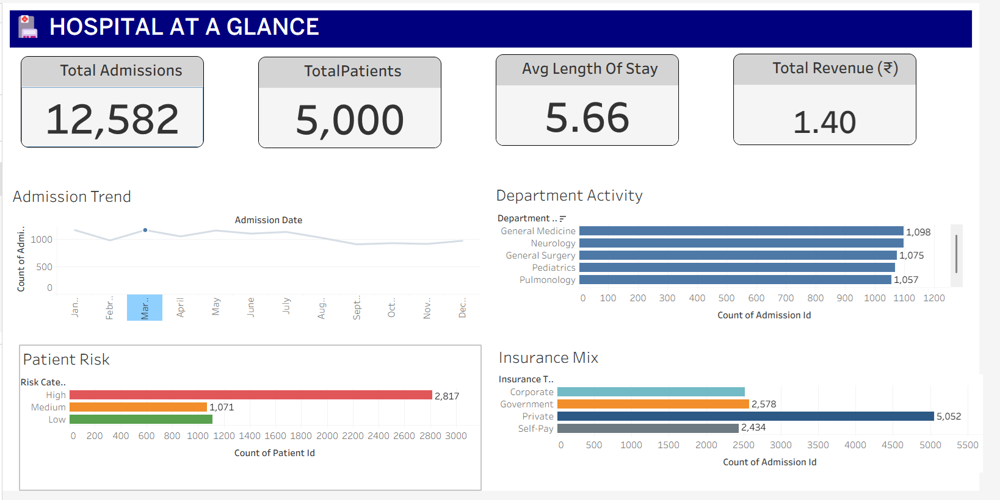
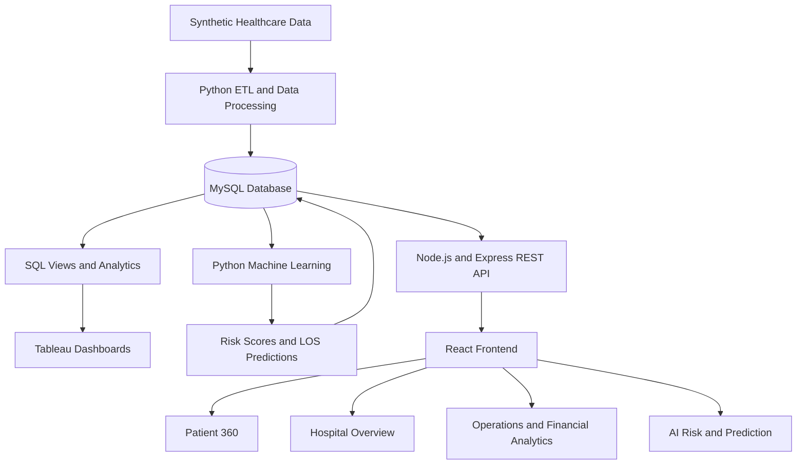

# 🏥 Healthcare Patient 360 & Hospital Intelligence

### Turning healthcare data into actionable hospital insights.

An end-to-end healthcare analytics platform that brings together patient information, hospital operations, financial performance, and machine learning predictions in one unified application.

Built with **MySQL, Python, Scikit-learn, Tableau, React, Node.js, and Express**, this project demonstrates how healthcare data can be transformed into interactive dashboards, patient-level insights, and predictive analytics.

<p align="center">
  
  
  
  
  
  
</p>

<p align="center">
  <a href="https://github.com/VarshneyPrachi/Health-Care-Patient-360">Repository</a>
  ·
  <a href="#-features">Features</a>
  ·
  <a href="#-tableau-dashboard-gallery">Dashboard Gallery</a>
  ·
  <a href="#-installation--setup">Installation</a>
</p>

---

## 📌 Table of Contents

- [Overview](#-overview)
- [Problem Statement](#-problem-statement)
- [Features](#-features)
- [Tableau Dashboard Gallery](#-tableau-dashboard-gallery)
- [Technology Stack](#-technology-stack)
- [System Architecture](#-system-architecture)
- [Project Structure](#-project-structure)
- [Database Design](#-database-design)
- [ETL and Data Analytics](#-etl-and-data-analytics)
- [Machine Learning](#-machine-learning)
- [REST API](#-rest-api)
- [Installation & Setup](#-installation--setup)
- [Running the Application](#-running-the-application)
- [Results](#-results)
- [Limitations and Responsible Use](#-limitations-and-responsible-use)
- [Future Enhancements](#-future-enhancements)
- [Author](#-author)

---

## 🔍 Overview

Healthcare Patient 360 is a full-stack analytics project designed to provide a consolidated view of patient records and hospital performance.

It combines relational database management, Python-based data processing, machine learning, business intelligence dashboards, and a React web application.

The platform includes:

- **Patient 360:** Patient-level information, admission history, financial summaries, and model-generated risk estimates.
- **Hospital Intelligence:** Executive-level KPIs for admissions, patient volumes, length of stay, and revenue.
- **Operations & Clinical Analytics:** Department activity, emergency admissions, doctor workload, and laboratory trends.
- **Financial Intelligence:** Revenue distribution, insurance coverage, patient payments, and payment status.
- **AI Risk & Prediction:** Demonstration models for readmission risk estimation and length-of-stay prediction.

The project uses synthetic data and is intended for learning, portfolio demonstration, and analytical experimentation.

## 🎯 Problem Statement

Healthcare organizations can have patient, admission, clinical, and billing information distributed across different systems. Analysing these datasets independently can make it difficult to obtain a consistent view of hospital performance.

This project addresses that analytical challenge by building a unified workflow that:

1. Organizes healthcare data in a relational database.
2. Processes and analyses the data using Python and SQL.
3. Generates predictive estimates using machine learning.
4. Presents business and operational insights in Tableau.
5. Exposes data through REST APIs.
6. Displays the results through an interactive web application.

## ✨ Features

### 🧑‍⚕️ Patient Intelligence
- Patient search by ID, city, and department.
- Consolidated patient profile.
- Patient demographics and insurance information.
- Admission and treatment-related analytical indicators.
- Estimated readmission risk and predicted length of stay.
- Patient-level billing and insurance summaries.

### 📊 Hospital Analytics
- Total patients and admissions.
- Average length of stay.
- Revenue and billing indicators.
- Department-level performance.
- Admission trends and emergency admission analysis.

### 💰 Financial Intelligence
- Total billed revenue.
- Insurance-covered amounts.
- Patient-paid amounts.
- Average bill value.
- Revenue by insurance category and department.
- Payment-status analysis.

### 🤖 Machine Learning
- Logistic Regression and Random Forest readmission classifiers.
- Linear Regression and Random Forest length-of-stay models.
- Feature-importance analysis.
- Patient-level risk scores.
- Admission-level length-of-stay predictions.

### 🌐 Full-Stack Web Application
- React-based dashboard interface.
- Searchable patient directory.
- Individual Patient 360 pages.
- Interactive charts and KPI cards.
- Express REST API connected to MySQL.

## 📸 Tableau Dashboard Gallery

The following dashboards provide an executive and operational view of the healthcare dataset.

### 1. Hospital at a Glance



An executive overview of patient volumes, admissions, average length of stay, hospital revenue, department activity, patient-risk categories, and insurance mix.

### 2. Operations & Clinical


A closer look at department admissions, emergency activity, average length of stay, doctor workload, and laboratory analytics.

### 3. Financial Intelligence


A financial overview covering billed revenue, insurance coverage, patient payments, revenue by insurance type, department-level revenue, and payment status.

> **Note:** These images are loaded from the repository's `tableau/screenshots/` folder. Add your actual Tableau screenshots using the filenames shown above for them to appear here.

## 🛠️ Technology Stack

| Layer | Technologies |
|---|---|
| Frontend | React, Vite, JavaScript, CSS |
| Charts | Recharts |
| Backend | Node.js, Express.js |
| API communication | Axios, REST APIs |
| Database | MySQL 8 |
| Data processing | Python, Pandas, NumPy |
| Machine learning | Scikit-learn |
| Visualization | Tableau |
| Development tools | VS Code, MySQL Workbench, Git, GitHub |

## 🏗️ System Architecture



### Data Flow

1. Synthetic healthcare data is generated and stored in structured files or database tables.
2. Python scripts generate, process, and analyse the data.
3. MySQL stores patient, doctor, department, admission, diagnosis, treatment, laboratory, and billing records.
4. Machine learning scripts produce risk scores and length-of-stay predictions.
5. SQL queries and views support operational and financial analysis.
6. Tableau presents the analytical results.
7. The Express backend exposes data through REST endpoints.
8. The React frontend consumes the APIs and presents interactive views.

## 📁 Project Structure

```text
Healthcare-Patient-360/
│
├── backend/
│   ├── config/
│   │   └── db.js
│   ├── controllers/
│   ├── routes/
│   ├── server.js
│   ├── package.json
│   └── .env.example
│
├── frontend/
│   ├── public/
│   ├── src/
│   │   ├── layouts/
│   │   ├── pages/
│   │   ├── services/
│   │   ├── App.jsx
│   │   └── App.css
│   ├── package.json
│   └── .env.example
│
├── database/
│   ├── schema/
│   ├── seeds/
│   ├── queries/
│   └── views/
│
├── data/
│   ├── raw/
│   └── processed/
│
├── ml/
│   ├── notebooks/
│   ├── models/
│   └── outputs/
│
├── python/
│   ├── etl/
│   ├── analysis/
│   └── utils/
│
├── tableau/
│   └── screenshots/
│
├── docs/
├── requirements.txt
├── .gitignore
└── README.md
```

Some directories may be empty or contain additional files as the project evolves.

## 🗄️ Database Design

The main relational database is `healthcare_analytics`.

| Table | Purpose |
|---|---|
| `departments` | Hospital departments and capacity |
| `patients` | Patient demographics and insurance |
| `doctors` | Doctor and specialization information |
| `admissions` | Admission, discharge, and length-of-stay records |
| `diagnoses` | Diagnosis details and severity |
| `treatments` | Treatment records and costs |
| `lab_results` | Laboratory test results and status |
| `billing` | Bills, insurance coverage, and patient payments |
| `ml_patient_360` | Consolidated model-generated patient analytics |

SQL views provide reusable datasets for patient profiles, admission analytics, department performance, financial analytics, doctor performance, and laboratory analysis.

## 🔄 ETL and Data Analytics

The Python pipeline supports synthetic data generation, database loading, exploratory data analysis, and analytical dataset preparation.

Core tasks include:

- Generating linked healthcare entities.
- Preparing patient and admission records.
- Calculating admission-level statistics.
- Analysing revenue and billing patterns.
- Summarizing laboratory results.
- Preparing features for machine learning.
- Combining predictions into a patient-level analytical dataset.

The generated dataset includes approximately **5,000 patients and 12,582 admissions**.

## 🤖 Machine Learning

Two predictive tasks are implemented.

### 1. Readmission Risk Estimation

**Objective:** Estimate the probability of a synthetic patient record being associated with a generated 30-day readmission label.

Models:
- Logistic Regression
- Random Forest Classifier

| Metric | Logistic Regression | Random Forest |
|---|---:|---:|
| Accuracy | 70.72% | 66.91% |
| Precision | 56.48% | 51.71% |
| Recall | 71.66% | 84.01% |
| F1-score | 0.6317 | 0.6402 |
| ROC-AUC | 0.7805 | 0.7871 |

The Random Forest model provides higher recall and slightly higher F1-score and ROC-AUC in the current evaluation. Logistic Regression has higher accuracy and precision.

### 2. Length-of-Stay Prediction

**Objective:** Predict the number of hospital-stay days using admission-related features.

Models:
- Linear Regression
- Random Forest Regressor

| Metric | Linear Regression | Random Forest |
|---|---:|---:|
| MAE | 2.2301 days | 2.2414 days |
| RMSE | 2.7214 days | 2.7332 days |
| R² | 0.3256 | 0.3197 |

Linear Regression performs slightly better on the reported test metrics and is the current selected model for this task.

### Model Interpretation

The analysis scripts also generate feature-importance outputs and evaluation visualizations to help examine which features influence model predictions.

The current models are demonstration models trained on synthetic data. Their metrics should not be interpreted as evidence of real-world clinical performance.

## 🔌 REST API

The backend runs on port `5000` by default.

### Health Check

| Method | Endpoint | Description |
|---|---|---|
| GET | `/api/health` | Checks backend and database connectivity |

### Patient APIs

| Method | Endpoint | Description |
|---|---|---|
| GET | `/api/patients` | Retrieve patients |
| GET | `/api/patients?search=P00016` | Search patient records |
| GET | `/api/patients/P00016` | Retrieve a specific patient |

The search endpoint supports patient ID, city, and department matching.

### Dashboard APIs

| Method | Endpoint | Description |
|---|---|---|
| GET | `/api/dashboard/summary` | Hospital summary KPIs |

### Operations APIs

| Method | Endpoint | Description |
|---|---|---|
| GET | `/api/operations/departments` | Department performance |
| GET | `/api/operations/doctors` | Doctor performance |
| GET | `/api/operations/labs` | Laboratory analytics |

### Financial APIs

| Method | Endpoint | Description |
|---|---|---|
| GET | `/api/financial/summary` | Financial summary |
| GET | `/api/financial/by-insurance` | Revenue by insurance type |
| GET | `/api/financial/by-department` | Revenue by department |
| GET | `/api/financial/payment-status` | Payment-status distribution |

### AI APIs

| Method | Endpoint | Description |
|---|---|---|
| GET | `/api/ai/risk-distribution` | Patient risk distribution |
| GET | `/api/ai/risk-by-department` | Readmission risk by department |
| GET | `/api/ai/los-distribution` | Predicted length-of-stay distribution |
| GET | `/api/ai/patient/P00016` | Patient-specific AI analytics |

**Example response for `/api/health`:**

```json
{
  "status": "success",
  "message": "Backend and MySQL are connected",
  "database": true
}
```

## 💻 Installation & Setup

### Prerequisites

Install the following software:

- Git
- Node.js and npm
- Python 3.10 or later, compatible with the installed packages
- MySQL Server 8 and MySQL Workbench

### 1. Clone the Repository

```bash
git clone https://github.com/VarshneyPrachi/Health-Care-Patient-360.git
cd Health-Care-Patient-360
```

### 2. Configure MySQL

1. Start MySQL Server.
2. Open MySQL Workbench.
3. Run the database creation script in `database/schema/01_create_database.sql`.
4. Run `database/schema/02_create_tables.sql`.
5. Confirm that the required tables and relationships exist.

If using an existing populated database, avoid rerunning data-generation scripts unnecessarily.

### 3. Configure the Backend

```bash
cd backend
npm install
```

Create a local `.env` file by copying `.env.example`.

Configure it with your local MySQL credentials:

```env
PORT=5000
DB_HOST=localhost
DB_PORT=3306
DB_NAME=healthcare_analytics
DB_USER=your_mysql_username
DB_PASSWORD=your_mysql_password
```

Keep this file private and never commit it.

### 4. Configure the Frontend

Open a separate terminal from the project root:

```bash
cd frontend
npm install
```

Create `frontend/.env` using the example file:

```env
VITE_API_URL=http://localhost:5000/api
```

### 5. Set Up Python

From the project root:

```bash
python -m venv venv
```

Activate the environment in Windows PowerShell:

```powershell
.\venv\Scripts\Activate.ps1
```

Install dependencies:

```bash
python -m pip install --upgrade pip
pip install -r requirements.txt
```

If PowerShell blocks activation, use the appropriate local execution-policy setting or run the environment's Python executable directly.

## ▶️ Running the Application

Run each component in a separate terminal.

### Terminal 1 — Backend

```bash
cd backend
npm run dev
```

The backend should be available at:

`http://localhost:5000`

Test the database connection:

`http://localhost:5000/api/health`

### Terminal 2 — Frontend

```bash
cd frontend
npm run dev
```

Open the local URL printed by Vite in your terminal, usually:

`http://localhost:5173`

### Terminal 3 — Python Analytics

Activate the virtual environment from the project root, then run the relevant scripts as needed.

For example:

```bash
python python/analysis/healthcare_eda.py
```

The machine learning scripts under `ml/notebooks/` are Python scripts despite the directory name. Execute them in the documented pipeline order when regenerating models and predictions. Ensure the database configuration and required input data are ready first.

### Tableau

Open Tableau Desktop and connect to the MySQL `healthcare_analytics` database. Use the analytical views and tables to build or refresh the dashboards. A suitable MySQL user with read-only permissions is recommended for visualization.

## 📈 Results

The current synthetic dataset provides the following baseline:

| Indicator | Current Result |
|---|---:|
| Patients | 5,000 |
| Admissions | 12,582 |
| Departments | 12 |
| Average length of stay | 5.66 days |
| Average bill | ₹111,586.73 |
| Total billed revenue | ₹1,403,984,256.45 |
| Abnormal laboratory result rate | 17.84% |
| Emergency admission share | 30.64% |

These figures describe the generated dataset, not actual hospital performance.

## ⚠️ Limitations and Responsible Use

- The project uses synthetic healthcare records rather than real patient data.
- The readmission target is synthetically generated and does not represent a clinically validated outcome.
- Risk thresholds and risk categories are demonstration settings.
- Predictive performance on synthetic data may not generalize to real clinical settings.
- Predictions are for educational analysis and must not be used to make medical decisions.
- The project does not replace professional medical judgment, validated clinical systems, or hospital governance.

## 🚀 Future Enhancements

- Deploy the frontend and backend to cloud infrastructure.
- Introduce authentication, role-based access, and audit logging.
- Add automated data-quality checks and scheduled ETL.
- Improve model validation and calibration on suitable real-world datasets with appropriate permissions.
- Add automated tests and CI/CD workflows.
- Enhance dashboard filtering and export capabilities.
- Integrate secure monitoring and application logging.

## 👩‍💻 Author

**Prachi Varshney**

B.Tech — Information Technology

[GitHub Profile](https://github.com/VarshneyPrachi)

[Project Repository](https://github.com/VarshneyPrachi/Health-Care-Patient-360)

---

<p align="center">
  <b>Healthcare Patient 360 & Hospital Intelligence</b><br/>
  Turning data into insights, one patient record at a time.
</p>
